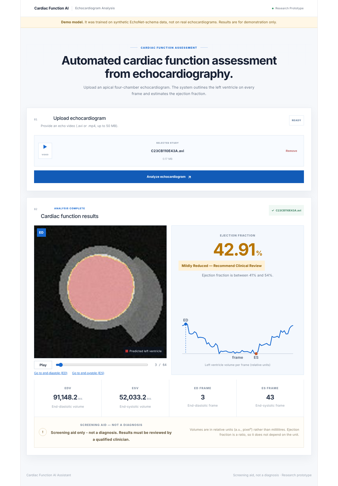
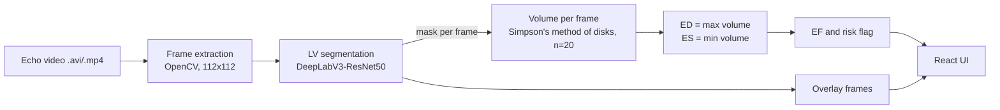

# Cardiac Function AI

[](https://github.com/YOUR-USERNAME/cardiac-function-ai/actions/workflows/ci.yml)

Upload an echocardiogram video. The app outlines the **left ventricle (LV)** on every frame,
computes the **ejection fraction (EF)** and shows a screening **risk flag**, all in a web page.

> **Screening aid only. Not a diagnosis and not a medical device.**
> The model in this repository is currently trained on *synthetic* data (see [Status](#status-and-honest-results)).



**Live demo:** _add your Hugging Face Space URL here after deploying (see [DEPLOYMENT.md](DEPLOYMENT.md))_

## Why

EF is the percentage of blood the left ventricle pumps out per beat:
`EF = (EDV - ESV) / EDV x 100`. Doctors measure it by tracing the LV by hand, frame by frame.
That is slow, differs between readers and needs specialist skills many small clinics do not
have. This project automates the tracing and the arithmetic as a lightweight screening layer.

| EF | Flag shown |
|---|---|
| 55 % or more | Normal |
| 41 - 54 % | Mildly Reduced - recommend clinical review |
| 40 % or less | Reduced - possible early HFrEF signal |

## How it works



| Layer | Folder | Interface |
|---|---|---|
| Segmentation (Track A) | `segmentation/` | `segment_video(path, model) -> (T,H,W) uint8 {0,1}` |
| EF engine (Track B) | `ef_engine/` | `compute_ef(masks) -> {edv, esv, ef_percent, ed_frame, es_frame, risk_flag}` |
| API + web app (Track C) | `app/` | `POST /analyze` (Contract 3) |

The layers only talk through these fixed contracts, so each can be improved on its own.

## Status and honest results

| Component | State |
|---|---|
| Pipeline (video -> mask -> EF -> UI) | Working end to end, covered by automated tests |
| Segmentation model | Trained on a **synthetic EchoNet-format dataset** (real EchoNet-Dynamic access was not available). Synthetic test Dice 0.86 / IoU 0.76 |
| EF accuracy | **Not yet validated on real data.** Do not cite EF error figures until it has been |
| Deployment | Docker image + Hugging Face Space recipe ([DEPLOYMENT.md](DEPLOYMENT.md)) |

The synthetic numbers prove that the code works, not that it works on real hearts. When the
real dataset is available, follow [Reproduce on real data](#reproduce-on-real-data); the web UI
shows a "Demo model" banner until the model metadata says `"real_data": true`.
Details and limitations: [docs/MODEL_CARD.md](docs/MODEL_CARD.md).

## Quick start

### Docker (one URL: API + UI)

```bash
docker build -t cardiac-function-ai .
docker run --rm -p 7860:7860 \
  -v "$PWD/segmentation/checkpoints:/home/appuser/app/segmentation/checkpoints:ro" \
  cardiac-function-ai
# http://localhost:7860
```

The checkpoint (`.pth`) is not in git because of its size; place it in
`segmentation/checkpoints/` or set `MODEL_URL` ([DEPLOYMENT.md](DEPLOYMENT.md)).

### Local development

```bash
python -m venv .venv && source .venv/bin/activate
pip install torch torchvision --index-url https://download.pytorch.org/whl/cpu
pip install -r requirements-dev.txt

# terminal 1 - backend
cd app/backend && uvicorn main:app --reload --port 8000

# terminal 2 - frontend (proxies API calls to :8000)
cd app/frontend && npm ci && npm run dev      # http://localhost:5173
```

### Tests

```bash
pytest -q                                   # backend, ML modules, EF maths
cd app/frontend && npm run lint && npm run build
```

## API (Contract 3)

`POST /analyze` with `multipart/form-data`, field `file` (.avi / .mp4 / .mov, up to 50 MB):

```json
{
  "ef_percent": 54.2, "edv": 122.4, "esv": 56.1,
  "risk_flag": "Mildly Reduced",
  "ed_frame": 14, "es_frame": 31,
  "overlay_frames_url": "/static/overlays/<request_id>/",
  "request_id": "...", "n_frames": 64, "fps": 50.0,
  "frame_pattern": "frame_{:04d}.jpg",
  "volume_curve": [ ... ], "volume_units": "relative (pixel^3), not millilitres",
  "warnings": [], "model": { "trained_on": "...", "real_data": false },
  "disclaimer": "Screening aid only - not a diagnosis. ..."
}
```

Fields after `overlay_frames_url` are additive extras; the original six contract fields never change.
Errors are JSON `{"detail": "..."}` with a meaningful status: `400` empty file, `413` too large,
`415` wrong type, `422` unreadable / too short / no ventricle found, `503` model not loaded.
`GET /health` reports whether the model loaded and what it was trained on.
Interactive docs at `/docs`.

## Repository layout

```
segmentation/   Track A - dataset tools, training, evaluation, segmentation_module.py (Contract 1)
ef_engine/      Track B - Simpson volume, EF, risk flag, validation (Contract 2)
app/backend/    FastAPI service (main.py) and overlay rendering
app/frontend/   React + Vite UI (video player with overlay, EF card, volume curve)
tests/          pytest suite (API, segmentation module, EF engine)
docs/           model card
deploy/         Hugging Face Space card and push script
Dockerfile      single image: builds the UI, serves everything with uvicorn
```

## Reproduce on real data

1. Request EchoNet-Dynamic (free, research use): <https://echonet.github.io/dynamic/>. Never commit the data.
2. Inspect and train (a GPU makes this far faster):

   ```bash
   cd segmentation
   python inspect_dataset.py --file-list <FileList.csv> --volume-tracings <VolumeTracings.csv>
   python train_segmentation.py --videos-dir <Videos> --file-list <FileList.csv> \
       --volume-tracings <VolumeTracings.csv> --epochs 15
   python evaluate.py --videos-dir <Videos> --file-list <FileList.csv> \
       --volume-tracings <VolumeTracings.csv> --checkpoint checkpoints/deeplabv3_lv_segmentation.pth
   ```
3. Validate EF on the test split: `python ef_engine/validate_ef.py ...` (see `ef_engine/`).
4. Put the real numbers in `docs/MODEL_CARD.md` and this README, edit
   `segmentation/checkpoints/deeplabv3_lv_segmentation.meta.json` (`"real_data": true`), redeploy.

## Limitations

- Not validated on real echocardiograms; not for clinical use.
- Volumes use relative pixel units (EF is a ratio, so it is unaffected).
- Single-plane (2D) estimate from one apical four-chamber view; clinical practice often uses biplane.
- ED/ES are the global max/min of the volume curve, so one bad mask can distort EF.

## Roadmap

- Train and evaluate on real EchoNet-Dynamic; publish real Dice/IoU and EF MAE/RMSE/R^2.
- Temporal smoothing of the volume curve for more robust ED/ES detection.
- Optional second opinion from EchoNet's `r2plus1d_18` video-to-EF model.

## Data, references and credits

- Ouyang D. et al., "Video-based AI for beat-to-beat assessment of cardiac function", *Nature* 2020 - EchoNet-Dynamic.
- Simpson's method of disks - standard echocardiographic LV volume technique.
- Built from the team's technical documentation (v2.0): Track A segmentation, Track B volume/EF logic,
  Track C integration and deployment.
